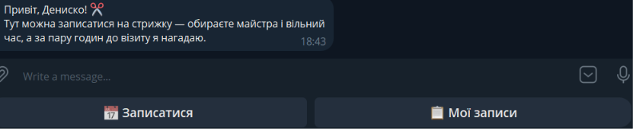
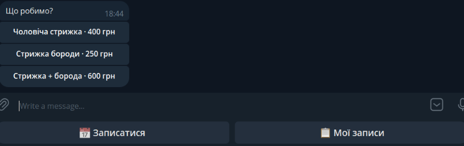
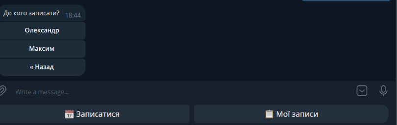
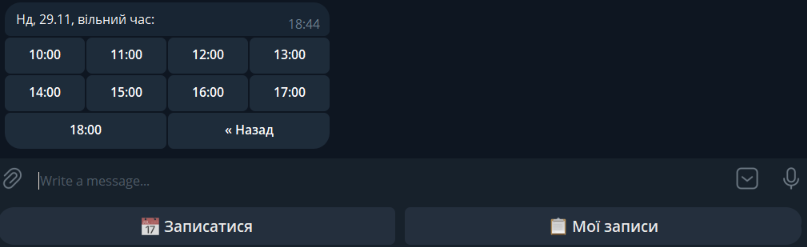
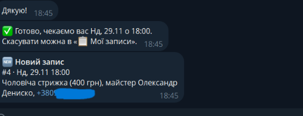

# barbertime-bot

Telegram-бот для запису в барбершоп. Клієнт обирає послугу, майстра, день і вільний час,
залишає номер і отримує нагадування за 2 години. Адмін бачить розклад, отримує сповіщення
про нові записи та скасування, може додавати послуги й майстрів командами.

Демо: [@barbertime_book_bot](https://t.me/barbertime_book_bot)

Стек: Python, aiogram 3, SQLite, APScheduler.

## Запуск

```
python -m venv .venv
.venv\Scripts\activate        # linux: source .venv/bin/activate
pip install -r requirements.txt
copy .env.example .env        # і заповнити токен та свій telegram id
python main.py
```

Години роботи, довжина слоту і т.д. — в `config.py`.

Команди адміна: `/admin`

<p>
  
  
  
</p>
<p>
  
  
  
</p>